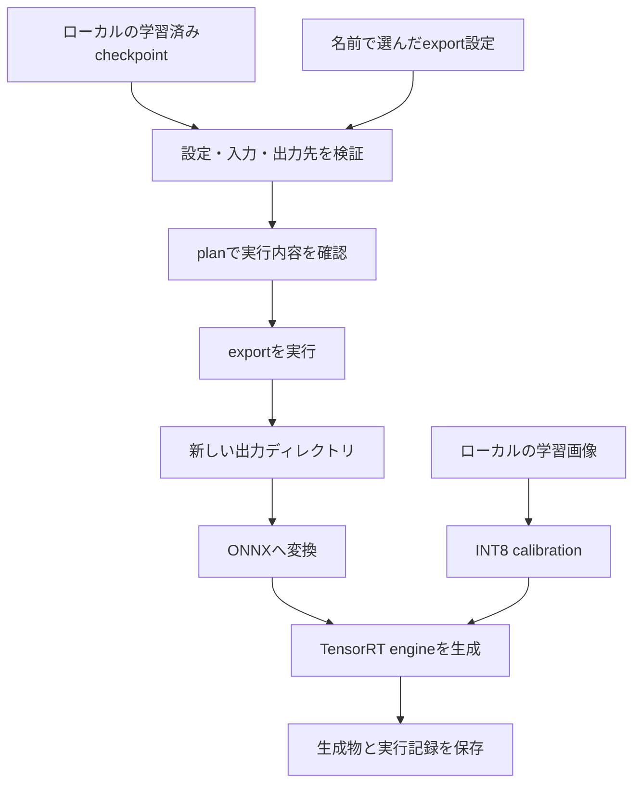

# 解法と設計

このプロジェクトでは、飲料の物体検出におけるデータ拡張の設計と、推論時間・ファイルサイズの制約に向けたTensorRT変換を説明します。対象外物体を加えるCopy-Pasteを学習へ接続する実装と、学習済みcheckpointからengineへの変換を提供します。

## 問題設定

画像から、飲料の矩形領域と銘柄を出力する物体検出が課題です。学習データは11,011枚、91クラスで、1枚に1～5個の飲料が含まれます。アノテーションはMS COCO形式で、矩形は左上のx・yと幅・高さをピクセル単位で表します。評価画像は非公開で、学習画像に含まれない背景や検出対象外の物体も含まれます。[公式課題説明](https://user.competition.signate.jp/ja/competition/detail/?competition=6e644a0277314ba2a1d36a1634f75f41&task=cc969d0e55a44990becf0c0688235765)

公式評価環境はNVIDIA T4、Ubuntu 22.04、vCPU 4、メモリ16 GB、インターネット接続なしです。64 MBは投稿ファイル全体の上限であり、engine単体の上限とは異なります。17.5 ms / 画像の制約は暫定評価・最終評価の両方に適用されます。[公式評価方法](https://user.competition.signate.jp/ja/competition/detail/?competition=6e644a0277314ba2a1d36a1634f75f41&task=cc969d0e55a44990becf0c0688235765)

## データ拡張の設計：対象外の缶を追加するCopy-Paste

### 狙いと正解ラベルの扱い

缶や飲料らしい見た目の物体があっても、検出対象の91クラスに該当するとは限りません。この拡張では、検出対象外の缶などを学習画像へ追加し、対象の銘柄と背景中の紛らわしい物体を区別するための負例として扱います。

貼り付ける物体は負例として扱うため、**追加物体には正解のクラスや検出枠を付けません**。貼り付け時には元画像の正解ラベルを保ちます。この設計は、素材が検出対象の91クラスに該当しないことが前提です。

素材一覧の`negative_class_ids`に、採用する素材側のクラス番号を明示します。この番号は検出対象の91クラスの番号とは別の分類です。コードは指定クラスの矩形だけを切り出しますが、そのクラス名や実際の写り込みから対象銘柄の有無を判断することはできません。利用者が素材内容と利用条件を確認して選びます。

### 貼り付けの手順

1. 明示した素材画像とYOLO形式のアノテーションから、指定クラスの矩形だけを切り出し、`negative_assets`として保持します。`crop_inset=0.1`で幅・高さの10%を合計で内側へ詰めます。各辺から5%を除く指定で、周囲の背景を減らします。輪郭マスクによる切り抜きは行いません。
2. 学習画像の正解枠の面積を基準に、素材の縦横比を保ったままリサイズします。異なる大きさの画像間で、そのまま貼り付けた際のサイズの不自然さを抑える意図です。
3. 正解枠と既に貼り付けた物体の枠に重ならない位置をランダムに探します。探索は1物体あたり最大50回とし、場所が見つからない場合や素材が画像に収まらない場合は、その貼り付けを見送ります。
4. 画像上の選んだ位置へ素材を貼り付けます。追加した矩形は次の物体との重なり判定に使い、正解ラベルには追加しません。

正解物体を覆わない配置にすることで、元の正解枠と画像内容の対応を保つ設計です。正解枠を持たない画像には、この面積基準の追加処理を適用しません。

### サイズと適用頻度の設定

| 項目 | 基本の設定例 | 面積に変化を付ける設定例 |
| --- | --- | --- |
| `probability`：適用確率 | 0.5 | 0.2 |
| `max_pastes`：追加を試みる最大個数 | 4 | 2 |
| `max_attempts`：1個あたりの配置探索回数 | 50 | 50 |
| `area_mode`：面積の選び方 | `"mean"` | `"jitter"` |
| 貼り付け面積 | 正解枠と配置済み物体の矩形面積の平均 | 正解枠の面積から基準値を選び、ランダムな係数を掛ける |

`probability`は画像に追加処理を試みる確率です。処理を行う場合、1個から`max_pastes`個の追加を試みます。位置やサイズの条件で見送ることがあるため、この値は追加成功数ではありません。

面積に変化を付ける設定では、正解枠の面積の20～80パーセンタイルに入る候補から基準面積を選びます。候補がなければ全体から選び、その**面積**に0.7～1.3倍の係数を掛け、画像面積の0.1～10%に収めます。大きさの極端な物体に引っ張られすぎず、追加物体の大きさに変化を持たせる設計です。

`CopyPasteConfig`でこれらの値を指定できます。確率を0にすると貼り付けません。素材の切り出し幅は`crop_inset`、`jitter`時の面積倍率は`area_jitter`、画像面積に対する面積の範囲は`area_fraction`で指定します。既定値はそれぞれ`0.1`、`(0.7, 1.3)`、`(0.001, 0.10)`です。

切り出しでは内側へ詰めた矩形と交わる画素を含めるように境界を切り下げ・切り上げ、貼り付け幅・高さは`round()`で画素単位の整数へ丸めます。

### 他の拡張との組み合わせ

実装では、MosaicなどのUltralytics標準拡張の後、画像とラベルをテンソルへ変換する`Format`の直前にCopy-Pasteを置きます。貼り付け時の正解枠は、その時点の`cls`・`instances`から読みます。既存の正解枠や入力画像を破壊的に変更しないため、データをメモリ上で再利用する場合も同じ画像へ貼り付けが累積しません。

貼り付けでは矩形の画素を置き換えます。元の素材の縦横比を保ってリサイズし、画像内へ収まる配置だけを採用します。

学習データへ反映する処理は次のとおりです。

| 処理 | 実装 |
| --- | --- |
| 素材の選別 | 明示した`negative_class_ids`の素材だけを切り出す |
| 正解ラベルの参照 | `Format`の直前で`cls`・`instances`を読み、正解枠の位置を取得する |
| workerへの反映 | データセット構築時に変換を登録してからworkerを起動する |
| Mosaic終了後の反映 | `build_transforms()`で変換を再構築するたびにCopy-Pasteを1回だけ組み込む |
| 学習終盤の無効化 | `on_train_epoch_start`で確率を更新し、変更時にworkerと先読みバッチを作り直す |

`copy_paste_stop_last_epochs=10`なら最後の10 epochでCopy-Pasteを無効化します。0なら学習終盤も設定した確率を維持します。検証データにはCopy-Pasteを挿入しません。[学習ループ](https://github.com/ultralytics/ultralytics/blob/v8.3.170/ultralytics/engine/trainer.py)、[データセット](https://github.com/ultralytics/ultralytics/blob/v8.3.170/ultralytics/data/dataset.py)、[データローダー](https://github.com/ultralytics/ultralytics/blob/v8.3.170/ultralytics/data/build.py)

学習の実行例は[学習の手順](training.md)、学習ループやworkerの自動テストは[モデル・変換設定とテスト](experiments.md)にあります。後述のINT8 calibrationは別の処理で、指定した学習画像の読み込みとサイズ調整だけを行います。Copy-Paste用の素材・生成画像は本リポジトリに同梱していません。

## TensorRT変換で比較する設定

| 設定 | 検討する理由 | 確認が必要な点 |
| --- | --- | --- |
| モデル系列・規模 | YOLO11 / YOLO12の異なる構成を扱う | モデルの大きさだけで精度や実行時間は決まらない |
| 入力解像度 | 正方形と長方形の入力、複数のサイズを比較する | サイズを上げると演算量・メモリ要求も変わる |
| FP16 / INT8 | 演算の数値精度を変えて変換する | INT8にはcalibrationが必要で、精度への影響を別途測定する |
| NMSの組み込み | 重複した候補を除く後処理をengineに含めるか選ぶ | raw出力とNMS付き出力では、後段で必要な処理が異なる |
| workspace | TensorRTが構築時に利用する作業メモリの上限を設定する | engineのファイルサイズや推論時メモリの上限ではない |

設定を変える際は、同じcheckpoint・評価画像・入力サイズ・後処理の条件をそろえて比較します。[推論・ベンチマーク](benchmark.md)では、実行条件と予測・時間の記録方法を説明しています。

## モデル構成とcheckpointを分ける

`build_model("yolo11m", num_classes=91)`は、モデル名から未学習の構成を生成します。モデル名はUltralyticsのYAML構成へ対応し、出力クラス数を指定できます。

一方、exportは`--weights`に指定した学習済みcheckpointを読み込みます。モデル名の選択だけでcheckpointの中身が別のモデルへ変わることはありません。checkpointに含まれる構成と重みを使って変換します。

学習には、モデル名をYAML構成へ対応させて`YOLO(...).train()`を呼びます。`CopyPasteTrainer`が学習データへの拡張を接続し、最適化・検証・checkpoint保存はUltralyticsの標準学習ループに任せます。学習用データの取得や検証分割の生成は含まないため、利用者が独立したtrain / valを用意します。

## 変換フロー



出力先を実行ごとに分けるのは、以前のengineやcalibration cacheとの混同を防ぐためです。変換元checkpointも実行ディレクトリに分けて扱い、元の保存場所に別の成果物を上書きしません。生成物・記録は非公開のまま管理します。

## コードの役割

| ファイル・ディレクトリ | 役割 |
| --- | --- |
| [`registry.py`](../src/axell_export/registry.py) | 8モデルの名前と構成、未学習モデルの生成 |
| [`assets.py`](../src/axell_export/assets.py) | 明示した素材一覧とクラス番号を検証し、対象外物体を切り出す |
| [`augmentation.py`](../src/axell_export/augmentation.py) | 正解枠を保ちながら対象外物体を追加するCopy-Paste |
| [`training.py`](../src/axell_export/training.py) | 学習データへの接続、Mosaic終了時の再構築、終盤の確率変更 |
| [`config.py`](../src/axell_export/config.py) | 9種類のpresetとexport引数の検証 |
| [`calibration.py`](../src/axell_export/calibration.py) | ローカルYAML・学習画像パスの検証、calibration用設定の保存 |
| [`runtime.py`](../src/axell_export/runtime.py) | 長方形入力を保つcalibration画像loader |
| [`exporting.py`](../src/axell_export/exporting.py) | 実行計画、GPU環境の検査、exportの実行と結果の記録 |
| [`cli.py`](../src/axell_export/cli.py) | 一覧表示、設定確認、`plan`・`export`のコマンド入口 |
| [`benchmark.py`](../src/axell_export/benchmark.py) | ローカル画像での推論、同期を含む時間計測、予測と条件の保存 |
| [`tests/`](../tests/) | 合成入力と代替backendを用いた自動テスト |

## INT8 calibration

INT8では、画像を流して数値の範囲を見積もるcalibrationを行います。この実装ではYAMLの`train`だけを候補とし、パス順でそろえた集合から固定seedで `round(画像数 × fraction)` 枚を重複なく抽出します。既定は `--calibration-selection seeded-random --calibration-seed 42 --fraction 0.30` です。固定seed抽出によりファイル名の先頭だけを選ぶ偏りを避けます。パス順の先頭から選ぶ場合は `--calibration-selection sorted-first` を指定します。`val`や`test`の画像は選択しません。

ランダム抽出だけでクラスや撮影条件の代表性を保証することはできません。あらかじめ代表画像を選べる場合は、そのパスを1行1件のテキストへ列挙し、YAMLの `train` にそのファイルを指定して `--fraction 1` で全件を使います。一覧内の相対パスは、そのテキストファイルがあるディレクトリを基準に解決します。少数画像で選択数が0枚になる場合は停止します。

`plan` と `export.json` には選択方式・seed・割合・採用順のパス・各画像のSHA-256を保存します。`plan` でもハッシュのため画像ファイルを読みますが、画像のデコードや書き換えは行いません。exportの事前確認、画像を読む前後、変換完了時に内容の変更を検出します。実行中は入力データを固定してください。画像一覧と記録は非公開の実行ディレクトリで管理します。

入力はUltralytics形式のローカルYAMLです。以下は**自分で用意した2クラスのデータ**を説明するための例で、競技の配布データではありません。クラス数と名前はcheckpointに合わせます。

```yaml
path: /path/private/my-dataset
train: images/train
names:
  0: class_a
  1: class_b
```

画像を`images/train/`に置きます。calibrationには画像だけを使うため、ラベルファイルは不要です。相対パスの`path`はYAMLがあるディレクトリを基準にし、`train`は`path`を基準に解決します。`path`を省略した場合はYAMLがあるディレクトリが基準です。URLや自動ダウンロードの指定は受け付けません。

長方形のengine入力に合わせ、calibration専用の画像loaderで次の処理を行います。

1. ローカル画像を読み込み、Ultralyticsの`LetterBox`で縦横比を保ちながら拡大・縮小し、512 × 768へ配置します。余白は灰色の114で埋めます。
2. RGB・uint8の`[1, 3, 512, 768]`形式でTensorRT側へ渡します。浮動小数点への変換と255による除算はTensorRTのcalibrator側で行います。

loaderは元画像の修復・上書き、ラベルの走査、データセット側のcache作成、フォントのダウンロードを行いません。TensorRTが生成するcalibration cacheは、他の成果物と同じ非公開の実行ディレクトリで管理します。[UltralyticsのLetterBox](https://github.com/ultralytics/ultralytics/blob/v8.3.170/ultralytics/data/augment.py)、[TensorRT calibration実装](https://github.com/ultralytics/ultralytics/blob/v8.3.170/ultralytics/utils/export.py)

この実装が生成するcalibration専用YAMLでは、Ultralyticsの入力形式を満たすために`val`も同じ学習画像を指します。これはcalibration専用の別名であり、独立した検証データを作る操作ではありません。学習・評価の分割として使用しないでください。

calibrationでは`split="train"`を明示し、上記のloaderへ検証済みの学習画像だけを渡します。全presetで`batch=1`と`dynamic=False`を指定します。Ultralytics 8.3.170ではINT8指定だけで`dynamic=True`へ変更する処理はありません。[固定バージョンのexport実装](https://github.com/ultralytics/ultralytics/blob/v8.3.170/ultralytics/engine/exporter.py)

配布画像のコンペ外利用は禁止されています。この手順を試す際は、自分で利用する権利のある画像を用意してください。

## NMSと公式評価の違い

NMS付きpresetはengine内に重複候補の除去を含め、rawのpresetはその処理を含めません。公式評価では最終的な予測の信頼度上位5件が対象ですが、exportのNMS設定は公式評価の件数制限そのものではありません。

NMS付きexportでは `--conf`、`--iou`、`--max-det` を設定・実引数に保存します。既定値は固定Ultralytics版と同じ `0.25 / 0.7 / 300` で、`max_det` は検出数の上限です。`conf=0` はライブラリ内で0.25へ変更されるため、このコードでは受け付けません。raw presetにはこれらのexport時上書きを適用せず、推論側で設定します。

engine内部で除いた低confidence候補は、推論時に閾値を下げても復元できません。APを比較する実験では閾値をそろえ、必要なら低いconfidence閾値で再exportするかraw engineを使用します。`axell-benchmark`では、NMS付きengineに異なるconfidence・IoUを指定した場合は停止します。[推論・ベンチマークの条件](benchmark.md)

この実装は公式提出用の処理やAP評価器を提供しません。保存する予測は信頼度上位 `max_det` 件ですが、engineの生成成功と、提出形式・精度・速度の要件を満たすことは、それぞれ別の確認項目です。
